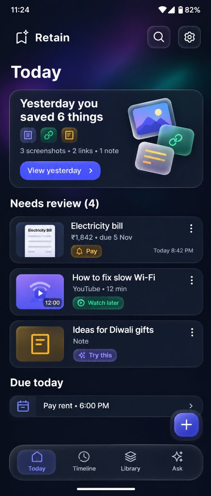
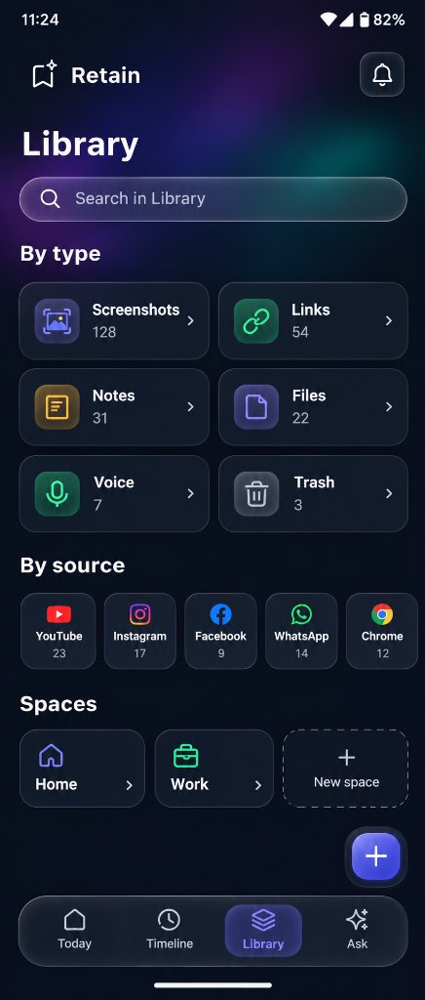
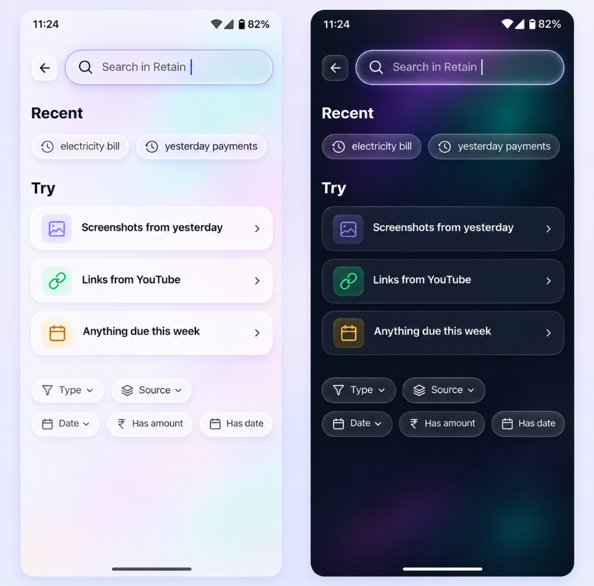
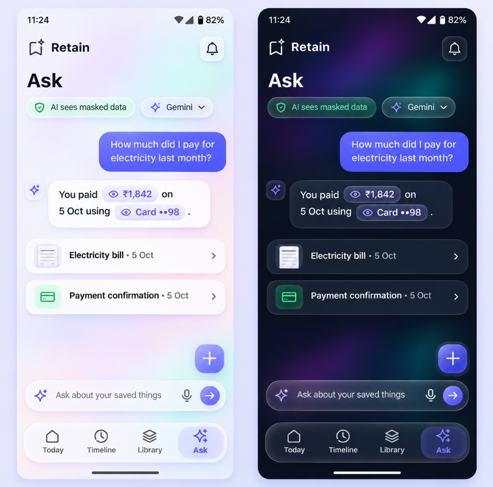
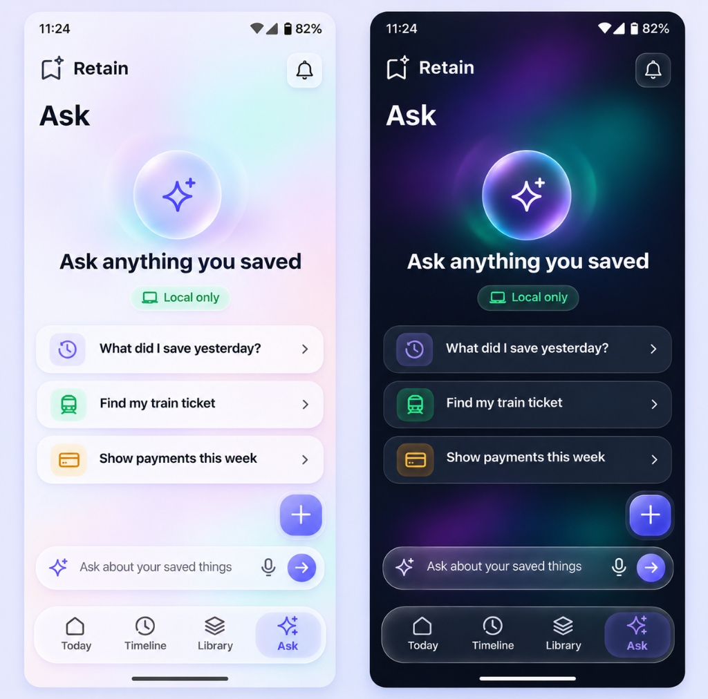

# 🔮 Premium Liquid Glass UI

> **Apple-inspired "liquid glass" design system and agent skill across Android (Jetpack Compose), iOS (SwiftUI), Flutter, and Web (CSS / Tailwind CSS).**

[](LICENSE)
[](#platform-templates)
[](https://agentskills.io/specification)

---

## ✨ Design Overview & Reference Gallery

Liquid glass is an interface material designed to feel calm, spatial, and expensive. It is used strictly for controls that float above content — never as a gimmick to sprinkle everywhere.

### Reference Screens

| Today View (Dark) | Library Overview (Dark) |
|:---:|:---:|
|  |  |

| Search & Filters (Light vs. Dark) |
|:---:|
|  |

| Conversational UI / Chat (Light vs. Dark) | Empty State / AI Assistant (Light vs. Dark) |
|:---:|:---:|
|  |  |

---

## 📐 The Five Hard Rules

1. **Content is Never Glass**  
   Cards, list items, tables, form fields, page backgrounds, and media stay completely opaque or soft-surface (`#131A2B` in dark, `#FFFFFF` in light).
2. **Glass Only on the Floating Layer**  
   Glass material is reserved exclusively for controls floating over scrolling content: bottom navigation pills, dynamic top bars, search pills, floating action buttons (FAB), bottom sheets, and floating context chips.
3. **Never Glass on Glass**  
   Inside a glass surface, never place another glass layer. Separate nested items using solid fills, hairline dividers, or opacity differences.
4. **Legibility Beats Looks**  
   Body copy requires a minimum **4.5:1** contrast ratio (large text and icons require **3.0:1**) over worst-case backgrounds. Fills are tinted with ink/surface tone (not pure translucent white) to preserve text contrast over bright backgrounds.
5. **Every Glass Surface Has a Solid Fallback**  
   Older OS versions, battery saver modes, and accessibility settings (**Reduce Transparency**) immediately swap glass for an opaque surface with a 1px border.

---

## 🎚️ Material Tiers

| Tier | Use Cases | Blur Radius | Dark Fill | Light Fill | Fallback |
|:---|:---|:---:|:---:|:---:|:---:|
| **None** | Content cards, lists, backgrounds | — | Opaque (`#131A2B`) | Opaque (`#FFFFFF`) | Same |
| **Thin** | Context chips, small floating controls | 16 dp/px | `#0F1526` @ 55% | `#FFFFFF` @ 55% | Solid tint + 1px border |
| **Regular** | Nav pill, top bar, search bar, FAB | 24 dp/px | `#0F1526` @ 66% | `#FFFFFF` @ 70% | Solid tint + 1px border |
| **Thick** | Bottom sheets, modal dialogs, drawers | 32 dp/px | `#0F1526` @ 78% | `#FFFFFF` @ 82% | Solid opaque surface |
| **Scrim** | Backdrop behind modal sheets | 0–8 dp/px | Black @ 20–45% | Black @ 20–45% | Black @ 35% |

---

## 📁 Repository Structure

```text
├── SKILL.md                          # Agent Skill instructions & rules
├── INSTALL.md                        # Quick install & setup guide
├── docs/
│   └── images/                       # UI design reference screenshots
├── assets/
│   ├── GlassTheme.kt                 # Android Jetpack Compose template
│   ├── GlassView.swift               # iOS SwiftUI template
│   ├── glass_theme.dart              # Flutter template
│   ├── glass.css                     # Standard Web CSS glass utilities
│   ├── tailwind-glass.config.js      # Tailwind CSS preset
│   └── tokens.json                   # Complete design token definitions
├── references/
│   ├── compose-implementation.md     # Jetpack Compose deep dive
│   ├── swiftui-implementation.md     # SwiftUI deep dive
│   ├── flutter-implementation.md     # Flutter deep dive
│   ├── web-implementation.md         # Web (CSS/Tailwind) deep dive
│   ├── components.md                 # Geometry, radiuses & component specs
│   ├── image-prompts.md              # AI image generation prompt formulas
│   ├── principles.md                 # Apple-inspired spatial design principles
│   ├── review-checklist.md           # Quality gates & anti-pattern audits
│   └── tokens.md                     # Color contrast proofs & math
├── scripts/
│   ├── contrast_check.py             # WCAG contrast validator (no network required)
│   └── audit_compose.py              # Static design-rule scanner for Compose
├── examples/                         # Test fixtures & sample components
└── premium-glass-android/            # Dedicated standalone Compose package
```

---

## 💻 Platform Templates

### 1. iOS (SwiftUI)
```swift
import SwiftUI

GlassSurface(tier: .regular, cornerRadius: 28) {
    HStack(spacing: 24) {
        TabItem(icon: "house.fill", label: "Today", isSelected: true)
        TabItem(icon: "clock.fill", label: "Timeline", isSelected: false)
        TabItem(icon: "sparkles", label: "Ask", isSelected: false)
    }
    .padding(.horizontal, 20)
    .padding(.vertical, 12)
}
```

### 2. Android (Jetpack Compose)
```kotlin
GlassSurface(
    tier = GlassTier.Regular,
    shape = RoundedCornerShape(28.dp),
    modifier = Modifier.padding(horizontal = 20.dp, vertical = 12.dp)
) {
    // Navigation items
}
```

### 3. Flutter
```dart
GlassSurface(
  tier: GlassTier.regular,
  borderRadius: 28.0,
  child: NavigationBarContent(),
)
```

### 4. Web (Tailwind CSS)
```html
<nav class="fixed bottom-6 left-1/2 -translate-x-1/2 z-50 h-16 px-6 
            backdrop-blur-xl bg-white/70 dark:bg-[#0F1526]/66 
            border border-white/60 dark:border-white/10 
            rounded-full shadow-2xl flex items-center gap-6">
  <!-- Nav items -->
</nav>
```

---

## 🤖 Installing as an AI Agent Skill

### Google Antigravity / Gemini CLI (Global)
Install globally to make this skill available across all your projects:
```bash
mkdir -p ~/.gemini/config/skills/premium-liquid-glass
cp -R * ~/.gemini/config/skills/premium-liquid-glass/
```

### Claude Code / Custom Agents
Place the repository folder in your skills directory:
```bash
# Project scope
cp -R . .claude/skills/premium-liquid-glass/
# Global scope
cp -R . ~/.claude/skills/premium-liquid-glass/
```

### Usage Prompts
Once installed, instruct your agent:
- *"Use `premium-liquid-glass` to design a floating navbar and modal sheet in SwiftUI."*
- *"Use `premium-liquid-glass` to build this screen in Jetpack Compose with accessibility fallbacks."*
- *"Use `premium-liquid-glass` to audit our UI for glass misuse and check contrast ratios."*

---

## 🧪 Validation & Testing

Validate your theme tokens and contrast ratios locally:
```bash
# Verify WCAG contrast for all tiers against worst-case backdrops
python3 scripts/contrast_check.py --tokens assets/tokens.json

# Audit Compose code for glass violations
python3 scripts/audit_compose.py path/to/compose/src
```

---

## 📄 License

Distributed under the [MIT License](LICENSE).
